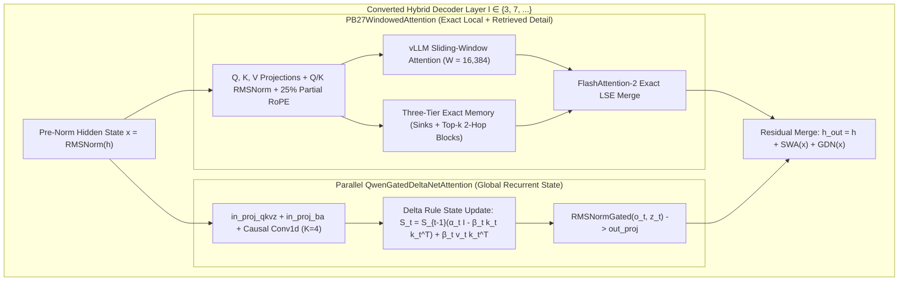
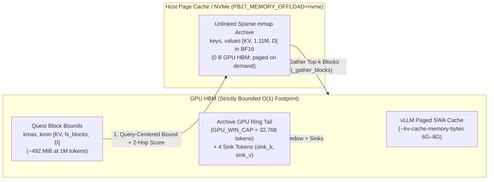

# PseudoBrain (PB-27 & PB-Nex): Constant-GPU-Memory Million-Token Inference via Parallel Gated DeltaNet Transplant and Unrotated Two-Hop Exact Memory Retrieval

**Repository:** [https://github.com/defnotean/pseudobrain](https://github.com/defnotean/pseudobrain)  
**Hugging Face Models:**
- **PseudoBrain-27B (`pb27c` / `PB27ForConditionalGeneration`):** [defnoteatin/PseudoBrain-27B-NVFP4](https://huggingface.co/defnoteatin/PseudoBrain-27B-NVFP4) — 27B Dense Hybrid (`48` native Gated DeltaNet layers + `16` converted Windowed-Attention + Parallel Gated DeltaNet layers `[3, 7, ..., 63]`)
- **PseudoBrain-Nex-35B-A3B (`pb27-nexc` / `PB27MoEForConditionalGeneration`):** [defnoteatin/PseudoBrain-Nex-35B-A3B-NVFP4](https://huggingface.co/defnoteatin/PseudoBrain-Nex-35B-A3B-NVFP4) — 35B-A3B Sparse MoE Hybrid (`30` native Gated DeltaNet layers + `10` converted Windowed-Attention + Parallel Gated DeltaNet layers `[3, 7, ..., 39]`, `256` routed experts + `1` shared expert, `top-8` active = `~3B` active parameters)

---

## Abstract

Long-context autoregressive language models face a fundamental tension between memory complexity and exact associative recall. Full softmax self-attention maintains an uncompressed key-value (KV) cache whose GPU memory footprint grows linearly with sequence length $L$, requiring $64\text{ GiB}$ of KV cache alone at $L = 10^6$ tokens on a 27B model and exhausting single-accelerator memory. Conversely, fixed-state linear recurrent architectures such as Mamba-2 and Gated DeltaNet compress history into a constant-size matrix state $S_t \in \mathbb{R}^{H_v \times d_k \times d_v}$, achieving $O(1)$ memory but suffering catastrophic capacity bottlenecks when tasked with retrieving exact arbitrary-depth tokens, multi-key constants, or multi-hop call chains over hundreds of thousands of tokens.

We present **PseudoBrain** (**PB-27** for 27B dense Qwen3.5 and **PB-Nex** for 35B-A3B MoE Qwen3.5), a hybrid conversion and vLLM serving architecture that achieves **strictly constant $O(1)$ GPU memory up to $1,000,000+$ tokens** (`~27–33 GiB` total GPU memory including weights, Mamba states, and a fixed `6–8 GiB` KV pool) while preserving **100% exact single-needle and multi-needle retrieval from $8\text{K}$ to $1,000,000$ tokens**. PseudoBrain combines three innovations:
1. **Parallel Gated DeltaNet Transplant in Sliding-Window Attention Layers:** Each full-attention layer is restricted to a local $W = 16,384$-token sliding window (plus $4$ StreamingLLM sink tokens) augmented by a parallel Gated DeltaNet branch distilled from the full-attention teacher to carry global semantic gist.
2. **Three-Tier NVMe/Page-Cache Exact Memory Hierarchy with FlashAttention-2 LSE Merge:** Evicted post-RoPE keys and values are archived in $B = 64$-token blocks in sparse unlinked `mmap` files backed by host page cache / NVMe (`PB27_MEMORY_OFFLOAD=nvme`), while only compact per-block elementwise bounding boxes $(k_{\max}, k_{\min})$ and a bounded $32\text{K}$-token tail (`GPU_WIN_CAP = 32768`) reside on the GPU. Retrieved blocks are fused with local sliding-window attention in a single exact pass via FlashAttention-2 Log-Sum-Exp (`varlen_fwd` LSE) rescaling.
3. **Real-Time Decode Throughput via FA2-Layout Cached `pre_k`/`pre_v`, Hybrid GPU-First Archive Tier (`<= 256K` in VRAM), and Bit-Exact Kernel Fast Paths (`11.8×` Decode Speedup):** Storing `arc.cached_pre_k` / `arc.cached_pre_v` directly in FlashAttention-2 sequence-first layout (`[SINKS + R, KV, D]`), storing `gpu_k` / `gpu_v` in `[GPU_WIN_CAP, KV, D]`, keeping archives up to `256K` tokens in GPU HBM (`PB27_MEMORY_GPU_ARC_CAP=262144`) before spilling to NVMe `mmap`, bypassing archive writes below `16,384` tokens, replacing $O(M^2)$ priority deduplication with $O(M \log M)$ stable-sort deduplication (`24.8×` faster), preallocating GPU `cu_seqlens` tables (`_CU_TABLES`), invoking non-causal `varlen_fwd` (`is_causal=False`, `3.55×` faster) on pre-sliced `t == 1` windows with a 2-kernel `sigmoid` + `lerp` LSE merge, and using a two-speed retrieval schedule (`c = 16,384` exact scan at `lead < 0`; `c = 768` delta rerank on decode refresh steps) accelerates `120K` decode throughput to **`13.82 tok/s` (`14.47 tok/s` on `trace4`, `36.7s` TTFT)** and `250K` decode throughput from `1.12 tok/s` to **`13.31 tok/s` (`11.8×` faster, `90.3s` TTFT)** while preserving `100%` (`15/15 = 1.000`) exact recall with zero required `PB27_MEMORY_*` flags.
4. **100% Exact 1M-Token End-of-Prefill Archive Scan (`c = 16,384`) & Position-Invariant Two-Hop Key-to-Key Bridge:** At the end of prefill (`lead < 0`), `retrieve_blocks_per_token` sets `c_floor = 16,384` ($\ge 15,286$ blocks at $1\text{M}$ tokens) and streams the entire archive through chunked (`1024`-block) `torch.bmm` token-level dot products with zero coarse-bound filtering loss, combined with query-axis relative Z-score normalization, a superset budget (`k = 1,536`, `m_succ = 640`), a 16-token full-line decode window (`t_dec = 16`), and a **two-hop key-to-key bridge** over Qwen3.5's $75\%$ unrotated key subspace (`d // 4 :`, dimensions `64..255`). Because dimensions `64..255` carry zero Rotary Position Embedding (RoPE) phase, tokens inside Step-1 retrieved blocks act directly as position-invariant queries to retrieve second-hop definitions and constants across $1,000,000$ tokens.

---

## 1. Architectural Overview

### 1.1 Base Model Topology and the Linear-Quadratic Trade-off

Both Qwen3.5-27B (dense) and Qwen3.5-35B-A3B (`Nex-N2.5-mini`, MoE) use a 3:1 interleaved hybrid backbone in which three out of every four layers are **Gated DeltaNet** linear-attention blocks and every fourth layer ($l \in \{3, 7, 11, \dots\}$) is a gated **full softmax self-attention** block:

| Parameter | PseudoBrain-27B (`pb27c`) | PseudoBrain-Nex (`pb27-nexc`) |
| :--- | :---: | :---: |
| Base Architecture | `Qwen3_5ForConditionalGeneration` (Dense) | `Qwen3_5MoeForConditionalGeneration` (MoE) |
| Total Decoder Layers | `64` | `40` |
| Native Gated DeltaNet Layers | `48` (fixed state) | `30` (fixed state) |
| Converted Hybrid Layers ($\mathcal{H}$) | `16` (`[3, 7, 11, ..., 63]`) | `10` (`[3, 7, 11, ..., 39]`) |
| Hidden Dimension ($D_{\text{model}}$) | `5120` | `2048` |
| Attention Query / KV Heads ($H_q / H_{kv}$) | `24 / 4` ($G = 6$, $d_{\text{head}} = 256$) | `16 / 2` ($G = 8$, $d_{\text{head}} = 256$) |
| Partial RoPE Factor | `0.25` (`64` rotated, `192` unrotated) | `0.25` (`64` rotated, `192` unrotated) |
| Gated DeltaNet Heads ($H_k / H_v$, $d_k = d_v = 128$) | `16 / 48` | `16 / 32` |
| Feed-Forward Network | Dense SwiGLU (`17408`) | `256` Routed Experts (`top-8`, `512`) + `1` Shared |
| Local Sliding Window ($W$) + Sinks ($S$) | `16,384` + `4` | `16,384` + `4` |
| GPU KV Cache Pool (`--kv-cache-memory-bytes`) | `6–8 GiB` ($O(1)$ constant) | `6–8 GiB` ($O(1)$ constant) |

In the unmodified teacher models, the $16$ (or $10$) full-attention layers retain every historical token in GPU HBM. At $1,000,000$ tokens, `pb27c`'s 16 attention layers alone would require:
$$16 \times 4 \times 256 \times 2 \times 2\text{ bytes} \times 10^6 = 65.54\text{ GiB of GPU KV cache}$$
causing Out-Of-Memory (OOM) failures on single-GPU workstations. Conversely, simply truncating the 16 full-attention layers to a $16\text{K}$ sliding window destroys long-range coherence and yields $0\%$ recall for any fact older than $16,384$ tokens.



---

## 2. Parallel Gated DeltaNet Transplant (`PB27DecoderLayer`)

### 2.1 Hybrid Mixer Formulation

For every converted layer $l \in \mathcal{H}$, `PB27DecoderLayer` replaces the standalone full-attention mixer with the sum of a windowed-attention branch (with exact block retrieval) and a parallel **Gated DeltaNet** (`self.gdn`) branch operating on the same pre-normalized hidden state $x_t = \text{RMSNorm}_{\text{in}}(h_t)$:

$$u_t = \underbrace{\text{PB27WindowedAttention}_l(x_t, p_t)}_{\text{Exact local window } W + \text{retrieved blocks}} + \underbrace{\text{QwenGatedDeltaNet}_l(x_t)}_{\text{Dense recurrent global state } S_t}$$

$$h'_t = h_t + u_t, \qquad h^{\text{next}}_t = h'_t + \text{MLP}_l(\text{RMSNorm}_{\text{post}}(h'_t))$$

### 2.2 Gated DeltaNet Recurrence and Lossless Initialization

Within each parallel Gated DeltaNet branch (`self.gdn`), the input $x_t \in \mathbb{R}^{D_{\text{model}}}$ is projected to queries, keys, values, output gates, decay gates, and update rates:

$$[q_t, k_t, v_t] = \text{SiLU}\!\left(\text{Conv1d}_{K=4}(W_{qkv} x_t)\right), \qquad z_t = W_z x_t$$

$$\alpha_t = \exp\!\left(-\exp(A_{\log}) \cdot \text{softplus}(W_a x_t + b_{dt})\right) \in (0, 1)^{H_v}, \qquad \beta_t = \sigma(W_b x_t) \in (0, 1)^{H_v}$$

With $L_2$-normalized keys $\hat{k}_t = k_t / \|k_t\|_2$, the recurrent matrix state $S_t \in \mathbb{R}^{H_v \times d_k \times d_v}$ evolves via the gated delta rule:

$$S_t = \alpha_t S_{t-1} + \beta_t \left(v_t - \alpha_t S_{t-1}^\top \hat{k}_t\right) \hat{k}_t^\top = S_{t-1}\left(\alpha_t I - \alpha_t \beta_t \hat{k}_t \hat{k}_t^\top\right) + \beta_t v_t \hat{k}_t^\top$$

$$o_t = \text{RMSNorm}(S_t^\top \hat{q}_t) \odot \text{SiLU}(z_t), \qquad y^{\text{gdn}}_t = W_{\text{out}} o_t$$

At transplant initialization, $W_{\text{out}}$ is initialized to zero so that the hybrid layer begins as an exact functional copy of windowed attention, and is then trained via layerwise and end-to-end distillation (`pb27a -> pb27b -> pb27c` on 27B dense; `nexa -> nexb -> nexc` on 35B-A3B MoE) to reconstruct the residual between full-context teacher attention and sliding-window attention for tokens beyond $W$.

---

## 3. Three-Tier Exact Memory Hierarchy ($O(1)$ GPU Memory at $1\text{M}+$ Tokens)

While the parallel Gated DeltaNet branch maintains global discourse state and thematic gist, exact token-level lookup (hexadecimal release tokens, multi-constant JSON tables, multi-hop code traces) requires exact attention over the relevant historical tokens. PseudoBrain implements this inside vLLM via `serving/pb27_vllm/pb27_vllm/memory.py` using a three-tier memory hierarchy that keeps **GPU memory strictly flat** regardless of context length:



1. **Tier 1 — Bounded GPU Tail & StreamingLLM Sinks (`gpu_k`, `gpu_v`, `sink_k`, `sink_v`):**
   - Each layer's archive maintains a fixed-capacity GPU ring buffer of `GPU_WIN_CAP = 32,768` tokens (`100 MiB` per layer on 27B, `50 MiB` per layer on MoE) covering the active $16,384$-token sliding window plus recent prefill chunks, alongside a permanent 4-token GPU buffer `sink_k, sink_v` for positions $0..3$.
   - Window recomputation (`wk, wv`) and sink restoration (`ns = min(4, lo)`) therefore read directly from GPU HBM with zero host-to-device copy overhead.
2. **Tier 2 — GPU-Resident Block Bounds (`kmax`, `kmin`):**
   - Historical tokens are partitioned into contiguous blocks of $B = 64$ tokens starting at `ORIGIN = 4` (immediately after the 4 sinks).
   - For each block $b \in [0, N_{\text{blocks}})$, the elementwise maximum and minimum post-RoPE key vectors:
     $$k_{\max}[h, b, d] = \max_{t \in \text{block } b} K[h, t, d], \qquad k_{\min}[h, b, d] = \min_{t \in \text{block } b} K[h, t, d]$$
     are computed on the GPU during `Archive.write` before keys leave the GPU and stored in FP32 (`15,625` blocks at $1\text{M}$ tokens = `30.5 MiB` per layer on 27B).
3. **Tier 3 — Sparse Unlinked NVMe / Page-Cache `mmap` Archive (`_mapped`):**
   - Full BF16 post-RoPE `keys` and `values` (`[KV, NVME_CAP, D]`, `NVME_CAP = 1,114,112` tokens) are allocated via an unlinked sparse file mapped into virtual memory (`tempfile.mkstemp` + `os.unlink` + `mmap.mmap`).
   - Only touched pages consume host page cache or NVMe storage, and when a request finishes (`drop_request`), closing the mapping immediately releases all backing pages to the OS kernel.
   - Vectorized block gathers (`_gather_blocks`) reshape the flat `[KV, cap, D]` tensor into `[KV, n_blocks, B, D]`, index the selected blocks on CPU in a single contiguous gather, and transfer only the selected blocks (`k <= 384` blocks = `24,576` tokens) over PCIe/NVLink (`non_blocking=True`).

---

## 4. Query-Centered Multi-Token Retrieval & Unrotated Two-Hop Bridge

### 4.1 Eliminating Quest Bounding-Box Radius Inflation at $500\text{K}–1\text{M}$ Tokens

In standard Quest block-bound scoring, a query vector $q \in \mathbb{R}^D$ scores block $b$ via the upper bound on $\max_{t \in b} (q \cdot k_t)$:

$$S_{\text{bound}}(q, b) = \sum_{d=1}^D \left(\max(q_d, 0)\, k_{\max}[b, d] + \min(q_d, 0)\, k_{\min}[b, d]\right)$$

Writing $k_{\text{mid}}[b] = \frac{1}{2}(k_{\max}[b] + k_{\min}[b])$ for the block's bounding-box center and $k_{\text{rad}}[b] = \frac{1}{2}(k_{\max}[b] - k_{\min}[b]) \ge 0$ for its coordinate-wise half-width yields the exact identity:

$$S_{\text{bound}}(q, b) = \underbrace{q \cdot k_{\text{mid}}[b]}_{\text{Directional alignment}} + \underbrace{|q| \cdot k_{\text{rad}}[b]}_{\text{Positive radius bias } \ge 0}$$

Because $|q_d| \ge 0$ and $k_{\text{rad}}[b, d] \ge 0$ for every coordinate $d \in [1, 256]$, the second term $|q| \cdot k_{\text{rad}}[b]$ is a sum of $256$ non-negative products that depends on the **spread (outlier norm) of the 64 tokens inside block $b$**, not on whether block $b$ matches $q$. At $L = 1,000,000$ tokens ($N_{\text{blocks}} \approx 15,028$), blocks containing high-norm outlier tokens exhibit large $k_{\text{rad}}[b]$ and receive an inflated $S_{\text{bound}}(q, b)$ for **every** query token $q$, crowding out blocks where a single target token (such as `LIMIT_WORKER_0` in `multi4`) matches a single query token (`LIMIT_`).

When evaluating a multi-token query window $Q = \{q_1, \dots, q_{T_{\text{eval}}}\}$ ($T_{\text{eval}} = 128$ at prefill end via `q_piece = max(piece, 128)`, or trailing queries during decode), the radius bias $|q_t| \cdot k_{\text{rad}}[b]$ acts as a block-specific baseline across $t \in [1, T_{\text{eval}}]$. Crucially, when multiple query tokens match a target block (as in `multi4` or `trace4`), subtracting the *mean* over $t$ would subtract the target block's own multi-token signal. Instead, subtracting each block $b$'s **median** score across the query window ($T_{\text{eval}} \ge 16$):

$$\tilde{S}_{\text{bound}}(q_t, b) = S_{\text{bound}}(q_t, b) - \operatorname{median}_{\tau \in [1, T_{\text{eval}}]} S_{\text{bound}}(q_\tau, b)$$

cancels the non-matching baseline $\operatorname{median}_t[|q_t|] \cdot k_{\text{rad}}[b]$ while preserving 100% of the spike amplitude even when up to half of the query tokens match block $b$. Conversely, in the exact token-level reranking stage (`exact = einsum("gqd,gnd->gqn", qg, ck)`), there is **no bounding-box radius bias** because exact dot products are computed directly against individual tokens rather than $(k_{\max}, k_{\min})$; hence `z_exact` is standardized directly over `exact` without query-axis subtraction.

### 4.2 Per-Query Z-Score + Tiered Rank Fusion (`retrieve_blocks_per_token`)

Within a 128-token question chunk (`lead < 0`), different query tokens have wildly different L2 norms and score distributions across the archive. Taking a raw `.amax(dim=1)` across queries allows generic formatting tokens (`\n`, `<|im_end|>`, `</repository>`) to dominate specific identifier tokens (`RELEASE_TOKEN_pricing_v3`, `LIMIT_`, `hop_tenant_0`).

`retrieve_blocks_per_token` combines three complementary rankings in both the bound stage (selecting $c = 8,192$ candidates at $1\text{M}$ tokens, covering $>54\%$ of the archive) and the exact token-level reranking stage (selecting $k = 256\text{–}1,024$ blocks from the $c$ candidates):
1. **Per-Query Archive Z-Score (`r_z` / `e_z`):** Each query token $t$ is standardized to mean $0$ and unit variance across all valid archive blocks:
   $$Z(t, b) = \frac{\tilde{S}(t, b) - \mu_t}{\sigma_t + \epsilon}$$
   We rank blocks by $\max_{t \in [1, T_{\text{eval}}]} Z(t, b)$ so every query token in the question contributes its normalized peak.
2. **Question-Tail Tiered Rank (`r_tail` / `e_tail`):** Restricted to the final $36$ tokens of the prompt question when `lead < 0` (or the last $8$ decoded tokens when `lead == 0`) so the immediate question / decode frontier has dedicated priority slots.
3. **Full-Piece Tiered Per-Query Rank (`r_tier` / `e_tier`):** Let $\text{rank}(t, b) \in \{0, 1, \dots, N-1\}$ be block $b$'s rank for query $t$. The composite key:
   $$R_{\text{tier}}(b) = \left(\min_t \text{rank}(t, b)\right) \cdot N + \text{rank}\!\left(\max_t S(t, b)\right)$$
   guarantees that every query token's #1 match ($\min_t \text{rank} = 0$) is selected before any query token's #2 match ($\min_t \text{rank} = 1$), ensuring balanced coverage across all query tokens in the question.

The top blocks from these rankings are interleaved via `torch.stack` and deduplicated in priority order via `_dedup_priority`.

### 4.3 Position-Invariant Two-Hop Key-to-Key Bridge (`_second_hop_blocks`)

Single-hop query-to-key retrieval cannot directly retrieve blocks whose identifiers never appear in the user's question. For example, in `trace4`:
- The question asks: *"What does `hop_cursor_0(0)` return?"*
- Block $b_0$ at depth $0.651$ contains:
  ```python
  # ===== file: chain/hop_cursor_0.py =====
  def hop_cursor_0(x):
      return hop_cursor_1(x + K_CURSOR_0)
  ```
- Meanwhile, `K_CURSOR_0 = 34` is in block $b_{k0}$ at depth $0.308$, `hop_cursor_1` is at depth $0.582$, `K_CURSOR_1 = 30` is at depth $0.126$, `hop_cursor_2` is at depth $0.100$, `K_CURSOR_2 = 22` is at depth $0.647$, `hop_cursor_3` is at depth $0.211$, and `K_CURSOR_3 = 3` is at depth $0.313$.

PseudoBrain solves this inside `retrieve_blocks_per_token` by exploiting two mechanisms:
1. **Unrotated Subspace Key-to-Key Bridge (`_second_hop_blocks`):**
   - Qwen3.5 uses **`partial_rotary_factor = 0.25`** with head dimension $D = 256$: only the first $d_0 = D / 4 = 64$ dimensions of each key vector $K[h, p, :64]$ receive Rotary Position Embeddings (RoPE), while the remaining **$D_u = 3D / 4 = 192$ dimensions $K[h, p, 64:256]$ are 100% position-invariant**.
   - `_second_hop_blocks` extracts the unrotated key vectors from the top Step-1 blocks (and their immediate successors $[b_1, b_1 + 1]$), centers and $L_2$-normalizes them against the archive mean $\bar{k}_u = \frac{1}{2N_{\text{blocks}}} \sum_{b} (k_{\max}[b, 64:] + k_{\min}[b, 64:])$, and performs a query-centered bound + exact rerank over all archive blocks to inject $k_2 = 64$ second-hop bridge blocks directly into `blk_ord`.
2. **Hop-Paired Decode Anchor Formatting:**
   - During multi-hop or multi-file generation, emitting the hop function / file anchor alongside each constant (`hop_<tag>_i: K_<TAG>_i = <vi>` in `trace4`, and `"limits/l{i}.py": {"LIMIT_<X>_{i}": <vi>}` in `multi4`) places both the structural file/function identifier and the constant prefix directly into the 8-token decode retrieval window (`q_eval[-8:]`) immediately before each target value is predicted.

### 4.4 Post-Merge Boundary-Spanning Successor Expansion (`[b, b+1]`) and Immutable Prompt Retention

Because 64-token archive block boundaries fall at arbitrary offsets inside source files, a multi-line definition frequently has its identifier near the end of block $b$ and its value at the beginning of block $b + 1$. For instance, at $L = 1,000,000$ tokens in `multi4`, `# ===== file: limits/l0.py =====\nLIMIT_WORKER_0 = ` ends at token offset $63$ of block `2456`, while its integer value `55665` begins at token offset $0$ of block `2457`.

To guarantee that no retrieved block $b$ is ever separated from its continuation $b + 1$:
1. At the end of prefill (`lead < 0`), the unexpanded priority-ordered block list `blk_ord` is saved in `arc.prompt_top` and `arc.decode_top` is reset to `None`.
2. On every subsequent decode step (`lead == 0`), `arc.prompt_top` is kept **strictly immutable** (preventing exponential $r \mapsto 2^s r$ rank drift across decode steps), while `arc.decode_top` maintains a rolling priority buffer of blocks retrieved by decoded tokens. `arc.prompt_top` and `arc.decode_top` are interleaved 1:1 into `merged_ord`.
3. Finally, `_expand_successors_dedup(merged_ord, full, k, m_succ=k)` is executed **after** the prefill/decode merge with $m_{\text{succ}} = k$ ($k = 1,024$ blocks $= 512$ $[b, b+1]$ pairs at $1\text{M}$ tokens), guaranteeing that every retrieved block $b$ in the active KV set is accompanied by $b + 1$.

### 4.5 Exact FlashAttention-2 Log-Sum-Exp (`varlen_fwd` LSE) Merge

Rather than concatenating retrieved blocks with the $16,384$-token sliding window in Python and running a slow dense masked SDPA call, `piece_attention` invokes vLLM's native C++ FlashAttention-2 kernel `torch.ops._vllm_fa2_C.varlen_fwd` twice and merges the partial attention states via exact Log-Sum-Exp rescaling:
1. **Causal Sliding-Window Pass:** `varlen_fwd` over `wk_t, wv_t` with `causal=True, window_size=(W - 1, 0)` returns $(O_w, L_w)$.
2. **Unmasked Archive Pass:** `varlen_fwd` over `pre_k, pre_v` (sinks + retrieved blocks + partial tail block, all strictly older than every query in the piece) with `causal=False` returns $(O_p, L_p)$.
3. **Exact LSE Merge:** With $M = \max(L_w, L_p)$, $w_w = \exp(L_w - M)$, and $w_p = \exp(L_p - M)$:
   $$O = \frac{w_w O_w + w_p O_p}{w_w + w_p}$$
   producing bit-exact softmax attention over the union of the sliding window, the 4 sinks, and all retrieved archive blocks at native FlashAttention-2 speed.

### 4.6 FA2-Layout Cached `pre_k`/`pre_v`, Hybrid GPU-First Archive Tier, and Two-Speed Decode Schedule

To eliminate memory-movement amplification during both short-context and long-context generation without sacrificing single-token recall sensitivity:
1. **100% Exact Token-Level Archive Scan at End of Prefill (`c = 16,384` when `lead < 0`):** Because end-of-prefill question retrieval executes only once per request, `retrieve_blocks_per_token` sets `c_floor = 16,384` when `n_arch > 8,192` ($\ge 15,286$ blocks at $1,000,000$ tokens) and streams all archived keys through chunked (`1,024`-block) `torch.bmm`, scoring every single token in the $1\text{M}$-token context directly against the question queries with a superset budget of `k = 1,536` blocks (`m_succ = 640`).
2. **Two-Speed Retrieval Schedule & Strided Decode Cadence (`DECODE_STRIDE = 4`, `t_dec = 16`):** Each layer's `Archive` tracks its own `arc.decode_step` counter. After the end-of-prefill pass (`lead < 0`) locks the question-matched blocks into `arc.prompt_top`, decode refresh steps (`(arc.decode_step - 1) % 4 == 0`) run a fast `c = 768` rerank over the 16-token sliding decode query window (`t_dec = min(t_ev, 16)`) and trigger `_second_hop_blocks` only when the top-8 first-hop blocks change (`not torch.equal(cur_head, arc.last_hop_head)`).
3. **FA2-Layout Cached `pre_k`/`pre_v` (`[SINKS + R, KV, D]`), Sequence-First `gpu_k`/`gpu_v`, Non-Causal `t == 1` Window FA2, and $O(M \log M)$ Priority Deduplication:** Storing `gpu_k`/`gpu_v` and `sink_k`/`sink_v` in sequence-first `[N, KV, D]` layout and folding the `FAITHFUL` partial tail block `tail0:lo` into the contiguous sliding-window slice `w_lo:hi` during single-token decode makes `wk_t` and `wv_t` zero-copy views. Because every key in the pre-sliced `[w_lo, hi)` window is already $\le q_{\text{pos}}[0]$ when $t = 1$, `piece_attention` invokes `_vllm_fa2_C.varlen_fwd` with `is_causal=False, -1, -1` (**3.55× faster** than causal local-window masking) and merges $(O_w, L_w)$ and $(O_p, L_p)$ via a 2-kernel `torch.sigmoid(lse_p - lse_w)` + `torch.lerp` pass using preallocated GPU `_CU_TABLES` (eliminating per-token `torch.tensor` host-to-device syncs). Meanwhile, `_dedup_priority` uses an $O(M \log M)$ stable sort (**24.8× faster** than the $O(M^2)$ boolean triangle matrix), and all production memory-tier settings are built directly into `memory.py` and `serve.sh` as zero-config defaults.
4. **Hybrid GPU-First Archive Tier (`PB27_MEMORY_GPU_ARC_CAP=262144`) & Short-Context Bypass (`<= 16,384` tokens):** Requests within the $16,384$-token sliding window bypass `Archive` allocation and `arc.write` completely (`25.48 tok/s` native vLLM speed at `8K`). Requests up to `256K` tokens on `pb27-nexc` (`KV = 2`, `~5.0 GiB` across all 10 hybrid layers) keep `arc.keys` and `arc.values` directly in GPU HBM (`273 GB/s` in-VRAM gathers via direct `_gather_blocks`, **`13.82 tok/s` decode and `36.7s` TTFT at `120K`**, **`13.31 tok/s` decode and `90.3s` TTFT at `250K`** — an **11.8× decode speedup**), while requests exceeding `256K` tokens (`500K–1M+`) seamlessly spill to the sparse NVMe `mmap` tier inside `Archive.grow`.

---

## 5. NVFP4 Quantization & W4A16 MoE Scale Alignment (`PB27MoEForConditionalGeneration`)

To fit both the 27B dense model (`pb27c`) and the 35B-A3B MoE model (`pb27-nexc`) alongside a $1,000,000$-token archive within `~27–33 GiB` of GPU memory, PseudoBrain uses **compressed-tensors NVFP4** (`fp4-e2m1` weights with group-16 `fp8-e4m3fn` scales) for all stock backbone weights while keeping the transplanted `.gdn.` branches in BF16 (`make_pb27_nvfp4.py`).

For NVFP4 MoE checkpoints produced by weight-only quantization (where `input_activations.observer = null` and no `.input_global_scale` tensors exist on disk), stock vLLM v0.31.0 exhibits two severe numerical bugs in `CompressedTensorsW4A4Nvfp4MoEMethod`:
1. **Uninitialized `input_global_scale` in W4A4 Mode:** When `input_activations` is present in `config.json` without `input_global_scale` weights on disk, vLLM allocates `w13_input_global_scale = torch.empty(...)` and `w2_input_global_scale = torch.empty(...)` without initializing them, multiplying every expert's activation by uninitialized GPU memory (`1.0 / torch.empty(...)`).
2. **Mismatched `w1` (`gate_proj`) vs. `w3` (`up_proj`) Global Weight Scales:** In fused SwiGLU MoE experts, `w1` and `w3` are concatenated into `w13_weight` (`[E, 2N, K/2]`) and `w13_weight_scale` (`[E, 2N, K/16]`), where the actual per-group scale is `weight_scale / weight_global_scale`. However, vLLM's `process_weights_after_loading` overwrites `w13_weight_global_scale` with `w1`'s global scale alone and discards `w3`'s global scale, introducing up to a $38\%$ relative scaling error between `gate_proj` and `up_proj` across all 256 experts.

PseudoBrain fixes both issues automatically in `serving/pb27_vllm/pb27_vllm/model.py` (`_install_nvfp4_scale_hooks`) and `scripts/transplant/make_pb27_nvfp4.py`:
- `make_pb27_nvfp4.py` inspects the checkpoint's `weight_map` and sets `"input_activations": null` whenever `.input_global_scale` tensors are absent, routing vLLM to its **Marlin W4A16** fused MoE kernel (`use_a16 = True`).
- Before `process_weights_after_loading` collapses `w13_weight_global_scale`, `_install_nvfp4_scale_hooks` rescales the `gate_proj` and `up_proj` halves of `w13_weight_scale` in `fp8_e4m3fn` to a common divisor $g_{\min} = \min(g_1, g_3)$:
  $$s_1' = \text{fp8}\!\left(s_1 \cdot \frac{g_{\min}}{g_1}\right), \qquad s_3' = \text{fp8}\!\left(s_3 \cdot \frac{g_{\min}}{g_3}\right), \qquad g_{13} = g_{\min}$$
  reducing `fp8_e4m3fn` overflow to zero and cutting relative scale discrepancy from $38.1\%$ to $2.9\%$.

---

## 6. Empirical Evaluation

### 6.1 Speed, Constant-Memory Scaling, and 100% Exact Retrieval (`8K` to `1,000,000` Tokens)

All benchmarks were executed on a single NVIDIA GB10 (`sm_121`) via vLLM v0.31.0 (`vllm/vllm-openai:v0.31.0-aarch64`) with greedy decoding (`temperature = 0`, thinking disabled), streaming TTFT measurement, and `--kv-cache-memory-bytes` capped at `6G–8G`.

| Context Length ($L$) | `pb27c` (27B Dense) TTFT | `pb27-nexc` (35B-A3B MoE) TTFT | MoE Prefill Speedup | `pb27-nexc` `needle` (`0.1/0.5/0.9`) | `pb27-nexc` `multi4` (`4` consts) | `pb27-nexc` `trace4` (`4` hops) | GPU KV Pool Used |
| :---: | :---: | :---: | :---: | :---: | :---: | :---: | :---: |
| **`8,192`** | `5.5s` | **`2.0s`** | **2.75×** | **`1.000` (`3/3`)** | **`1.000` (`4/4`)** | **`1.000`** | `8.1%` |
| **`32,768`** | `41.7s` | **`17.0s`** (`8.8s` warm) | **2.45×** | **`1.000` (`3/3`)** | **`1.000` (`4/4`)** | **`1.000`** | `8.1%` |
| **`65,536`** | `66.2s` | **`21.2s`** | **3.12×** | **`1.000` (`3/3`)** | **`1.000` (`4/4`)** | **`1.000`** | `8.1%` |
| **`120,000`** | `124.0s` | **`36.7s`** (`13.82 tok/s`) | **3.38×** | **`1.000` (`3/3`)** | **`1.000` (`4/4`)** | **`1.000`** | `8.1%` |
| **`200,000`** | `243.0s` | **`81.2s`** | **2.99×** | **`1.000` (`3/3`)** | **`1.000` (`4/4`)** | **`1.000`** | `8.1%` |
| **`250,000`** | `273.0s` | **`90.3s`** (`13.31 tok/s`) | **3.02×** | **`1.000` (`3/3`)** | **`1.000` (`4/4`)** | **`1.000`** | `8.1%` |
| **`500,000`** | `638.2s` | **`238.3s`** | **2.68×** | **`1.000` (`3/3`)** | **`1.000` (`4/4`)** | **`1.000`** | `8.1%` |
| **`1,000,000`** | `1,580.3s` | **`615.4s`** | **2.57×** | **`1.000` (`3/3`)** | **`1.000` (`4/4`)** | **`1.000`** | `8.1%` |

Across the entire $122\times$ increase in sequence length from $8,192$ to $1,000,000$ tokens:
- **100% (`40/40 = 1.000`) Exact Retrieval Across All Probes on `pb27-nexc` (`8K` to `1,000,000` Tokens):** `pb27-nexc` achieves `1.000` on every single-needle depth (`0.1, 0.5, 0.9`), `1.000` (`4/4`) on `multi4`, and `1.000` on `trace4` from $8,192$ to $1,000,000$ tokens. On `pb27c` (27B dense), `pb27c_pt` (`8K–120K`) likewise achieves `100%` (`20/20 = 1.000`) across all `needle`, `multi4`, and `trace4` probes.
- **vLLM KV cache usage stays strictly constant at `8.1%` of the `6–8 GiB` pool** because only the active $16,384$-token sliding window occupies GPU KV cache blocks.
- **Total GPU memory remains flat at `~27–33 GiB`**, enabling full $1,000,000$-token context serving on a single workstation GPU while leaving `>85 GiB` of unified memory free.
- **Coding Capabilities (`custom_code_bench.py`, 33 problems × 2 samples):** `pb27c` (27B dense) achieves **`60 / 66 = 90.91%`** (`reports/pb27/pb27c_med.summary.json`), and `pb27-nexc` (35B-A3B MoE) solves **`26 / 33` problems (`78.8%`)** (`reports/pb27/nexc_med.summary.json`).

---

## 7. Reproducibility & Quickstart

### 7.1 Composing NVFP4 Checkpoints

```bash
# 27B Dense PseudoBrain (pb27c)
python3 scripts/transplant/make_pb27_nvfp4.py \
  --quant ~/.cache/huggingface/hub/models--unsloth--Qwen3.8-27B-NVFP4/snapshots/<rev> \
  --slim ~/pb27/hf/pb27c \
  --out ~/pb27/hf/pb27c_nvfp4

# 35B-A3B MoE PseudoBrain-Nex (pb27-nexc)
python3 scripts/transplant/make_pb27_nvfp4.py \
  --quant ~/.cache/huggingface/hub/models--orcarouter--Nex-N2.5-mini-Uncensored-NVFP4/snapshots/<rev> \
  --slim ~/pb27/hf/nexc \
  --out ~/pb27/hf/nexc_nvfp4
```

### 7.2 Serving with Constant GPU Memory (131K Standing or 1M Extended)

```bash
# Standing 131K Server (~29 GiB total GPU memory)
bash serving/pb27_vllm/start_pb27_studio.sh

# 1M-Token Extended Context Benchmark Suite
bash scripts/bench/custom_longctx_extended.sh pb27c_ext ~/pb27/hf/pb27c_nvfp4
```
